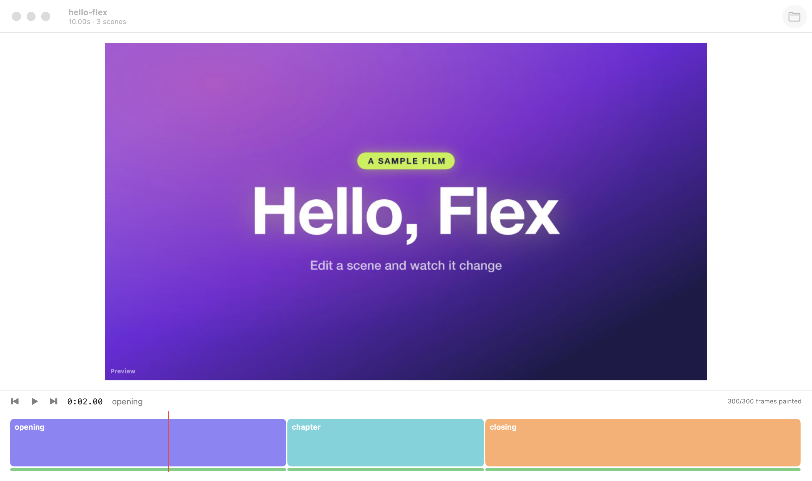

# Flex



Watch and steer a [fancy-e2e-videos](../fancy-e2e-videos) film while it's being built. Open a
project folder and it plays, with sound; edit a scene and only that scene refreshes; finished
renders show up next to the live preview.

The plan is in [plans/PRD.md](plans/PRD.md), what's left in [PLAN.md](PLAN.md).

## Today

- **Make a film from scratch:** `flex doctor`, `new`, `music` (the beat grid checked on the drum stem, each stem bar by
  bar, sung words with their times via local Whisper), `walk` (every page as each seat), `capture` / `pick`, and
  `render`. See [docs/making-a-film.md](docs/making-a-film.md).
- **Everyday tools, outside any project too:** `flex transcribe <audio or video>` (words with times, local Whisper) and
  `flex read <image or PDF>` (text with where each line sits, macOS's text recognition). `scripts/install-cli.sh` puts
  `flex` on your PATH (macOS has an unrelated `/usr/bin/flex`).
- **Capture:** journeys into take versions, with a timing report, preview and pick ([docs/capture.md](docs/capture.md)).
  The camera lane edits each take's zooms and effects in place.
- **Narration voice:** OpenAI with a key (Flex › Settings, or `flex key set openai`), else Kokoro.

- Open a project folder (File › Open Project…, ⌘O, or drop it on the app). Flex plans it with the pipeline's own
  planner: the scenes, their times and files, the music edit, the narration and sound cues.
- It plays the whole film, screen recordings included: frames are painted in Rust (several times faster than the
  pipeline's own paint), cached, and shown over the music edit. Scrub, loop a scene (double-click it, or L), step frames
  (←/→) and scenes ([ ]). Flex carries its own copy of the pipeline (`scripts/sync-pipeline.sh`), so no
  fancy-e2e-videos checkout is needed.
- Edit a file in the project and only the frames it changed repaint, a couple of seconds later.
- `flex` does it all from the terminal: `open`, `frame`, `warm`, `status`, `diff`, `watch`, `play`, `joins`, `accept`
  (the preview against a finished render), with `--variant NAME=VALUE` on any of them.

What it does, in detail: [docs/features](docs/features/README.md). Browse all the docs with
`scripts/docs.sh`.

## Build

```sh
scripts/copy-sample.sh        # the real sample film, into samples/circles-overview (not in git)
                              # samples/hello-flex is in the repo and opens without it
cargo test -p flex-core
scripts/package.sh            # Release build: quit Flex, install to /Applications, relaunch
```

Needs Rust, Xcode, `xcodegen` (`brew install xcodegen`), Node and ffmpeg. `scripts/sync-pipeline.sh` copies the pipeline
in from a fancy-e2e-videos checkout (only needed to refresh it; the copy is in the repo and ships inside the app), and
`scripts/seed-voices.sh` reuses that checkout's narration cache. More in [docs/agent-guide.md](docs/agent-guide.md).

## Release

`scripts/release.sh minor --publish` builds, signs, notarizes and publishes. Details in the
[agent guide](docs/agent-guide.md#releasing).
