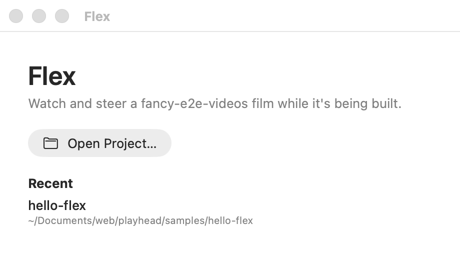

# Projects

A project is one fancy-e2e-videos film in its own folder: `project.ts`, `scenes/`, and usually
`look.ts`, `hits.ts`, `audio.json` and assets. Flex opens the folder and runs everything else
itself.

## Open a project

- **What:** Opens a film's folder in its own window. Each project gets one window.
- **Reach it:** File › Open Project… (⌘O), the start window's Open Project… and Recent list,
  dropping a folder on the app, or `open -a Flex <folder>`.
- **State:** The last ten projects are remembered as `recentProjects`
  (`defaults read dev.waky.flex`).
- **Limits:** A folder without `project.ts` doesn't open.

## Finding the pipeline

- **What:** Flex reads `project.ts`'s import of `…/fancy-e2e-videos/lib/project.ts`, resolved
  from the project folder, to find the checkout to run the film with. It then runs that
  checkout's own code: nothing about how a film is drawn is copied into Flex.
- **State:** None; it is read again on every open.
- **Limits:** The checkout needs `npm install`. A project copied elsewhere keeps working only
  at the same folder depth (its imports are relative). A project's own look is used from its
  folder, but its takes are still looked up in the pipeline's `takes/`
  ([pipeline-seam.md](../pipeline-seam.md), item 1).

## The samples

- **What:** `samples/hello-flex` is a ten-second film of built-in title cards, in the repo, for
  trying the app and for the tests. `samples/circles-overview` is the real sample (KinPay
  Circles' release film, about 77 s, six scenes, two of them takes).
- **Reach it:** Open either folder. `scripts/copy-sample.sh` copies circles-overview in from
  `~/Documents/web/kinpay-circles/release-videos/overview` (run it again for the latest).
- **Limits:** circles-overview is product content and stays out of git.

## When a project doesn't open

- **What:** The window says why: no `project.ts`, no pipeline import, a missing or uninstalled
  checkout, or the project's own error (its first lines), with Try Again (⌘R).
- **Limits:** A scene whose code throws doesn't stop the project opening: see
  [Timeline](03-timeline.md).
