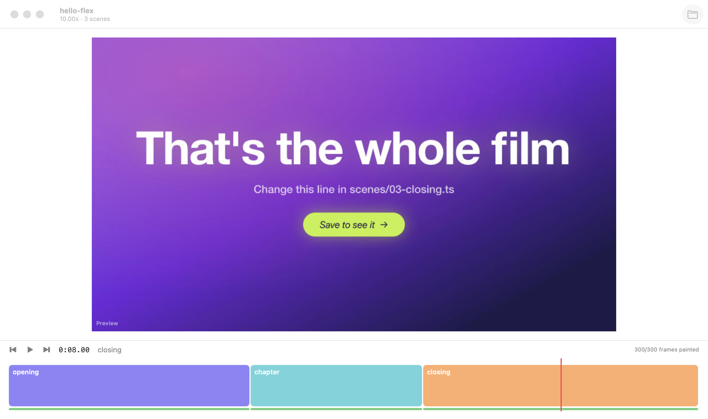

# Playback

## The viewer

- **What:** Shows the frame under the playhead, painted by Flex (a preview at 960 wide). When
  the playhead's frame isn't painted yet it keeps the last one and shows a "painting" badge, so
  it never shows a wrong frame.
- **State:** Frames come from the cache ([Painting](04-painting.md)).
- **Limits:** Takes show a placeholder ("Take circles-home") until the pipeline can describe
  them. A scene whose code threw shows its error instead.

## Play, pause and scrub

- **What:** Plays the film from the playhead over its music edit. While the music plays its
  clock is the film's clock, so picture and sound stay together; without music a timer runs it.
  Dragging on the timeline scrubs.
- **Reach it:** The play button or Space; drag or click the timeline.
- **State:** The playhead isn't remembered between launches.
- **Limits:** None of note; see Sound for what plays.

## Sound

- **What:** The film's real mix: every narration line (cards' `say` and takes' recorded
  narration), the sound effects (cards' `sfx`, takes' clicks and effect sounds) and the music
  edit with its crossfades, ducked and levelled by fancy-e2e-videos' own mixer, as a render
  would. Until it's ready (a few seconds after opening or an edit) the bare music edit plays, and
  playback switches over without stopping.
- **Reach it:** It plays with the picture. The transport says what's playing: "mixing the
  sound…", "narration + music", or "music only" (hover it when the mix failed).
- **State:** `~/Library/Application Support/Flex/mix/<hash>.wav`, keyed by the cues: an edit
  that moves no line or sound reuses the mix.
- **Limits:** A new or changed line is spoken by the pipeline's voice (OpenAI when its `.env`
  has a key, else local Kokoro) the first time, which takes a moment. Scrubbing is silent.

## Loop a scene

- **What:** Plays one scene over and over, from its first frame.
- **Reach it:** Double-click its block on the timeline, or L for the scene under the playhead.
  Stop Loop in the transport bar, or the same again, ends it.
- **Limits:** One scene at a time.

## Keys

| Key | Does |
|---|---|
| Space | Play / pause |
| ← / → | One frame back / forward |
| ⇧← / ⇧→ | One second |
| [ / ] | Previous / next scene (the first press of [ goes to this scene's start) |
| L | Loop the scene under the playhead |

## Launch options (for scripts)

`-openProject <path>` opens a project; `-startAt <frame>` puts the playhead there;
`-autoplay YES` plays once the music is ready, and `-mute YES` keeps it silent.
