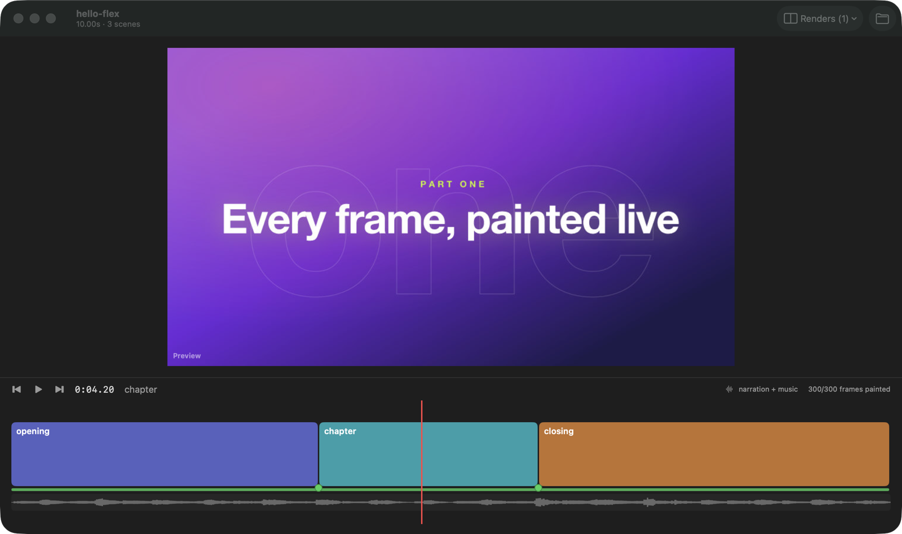

# Timeline

Top to bottom: the song's sections, a ruler (bars, hits, the edit's joins), the scenes with their
paint bars and a join dot on every boundary, the storyboard (when the project has a script: [Storyboard](10-storyboard.md)),
the camera, the music's waveform, and the narration. With beats planned past the film's end, the timeline runs on to the
plan's length.

## Scenes and the playhead

- **What:** A block per scene, as long as the scene, with its id; the red line is the
  playhead. A film icon marks a scene that holds a take.
- **Reach it:** Click or drag to move the playhead; double-click a block to loop it. Hover a
  block for its frames.

## Paint bars

- **What:** The thin bar under each block fills as the scene's frames are painted, green.
  A take's bar is grey: it has nothing to paint yet.
- **State:** Counted from the cache about twice a second.

## Narration

- **What:** Under the scenes, a block per spoken line, as long as the line, with its text; hover
  for the whole line and its time.

## Sections, bars and hits

- **What:** From the project's `markers` export (film seconds): the song's **sections** as labelled
  blocks along the top; the **bar grid** as light ticks on the ruler, every 4th bar stronger; the
  song's **hits** as small orange markers, with their label (and time) on hover.
- **State:** Read from the server's manifest on every reload.
- **Limits:** A project without `markers` shows none of these (hello-flex has none, so the
  screenshot above doesn't show them).

## The music edit's joins

- **What:** Blue ticks on the ruler mark where the song is spliced: every place one stretch of
  the song ends and the next begins. From `markers.joins` when the project exports them, else
  worked out from `music.segments`.

## Waveform

- **What:** The music, as played through its edit (the stretches back to back), on the film's
  clock, under the scenes.
- **State:** Decoded once by `ffmpeg` (mono, 8 kHz) and cached as peaks in
  `~/Library/Application Support/Flex/waveform/`, keyed by the file, its size and date, and the edit.
- **Limits:** The music only, not the full mix. Needs `ffmpeg` on the login PATH.

## The join check

- **What:** A dot on every scene boundary: **green** when the cut is seamless, **red** when the
  picture jumps, **white with scissors** when the project declares a deliberate hard cut there
  (`markers.cuts`), grey when it couldn't be checked. Hover a dot for the numbers.
- **How:** The engine paints the three frames around the boundary small (480 wide, cached like any
  frame) and takes the mean difference (0–255) across the cut (`first-1 → first`) and just before
  it (`first-2 → first-1`, the baseline). It jumps when `mean > max(3 × baseline + 1, 3)`: much more
  change than the motion leading in, and visible (a drop's bump or a moving cursor passes).
- **State:** Checked again after every reload, in the background.
- **Reach it from the terminal:** `flex joins <dir> [--json]` ([The flex command](06-cli.md)).

## A scene that didn't draw

- **What:** A scene whose code throws turns red with a warning sign, and the viewer shows its
  error (the first lines of the stack) on the frames that failed. The rest of the film plays
  and paints as normal; frames of that scene that do draw are shown.
- **Reach it:** Fix the code and save: the project reloads by itself
  ([Live refresh](05-live-refresh.md)).
