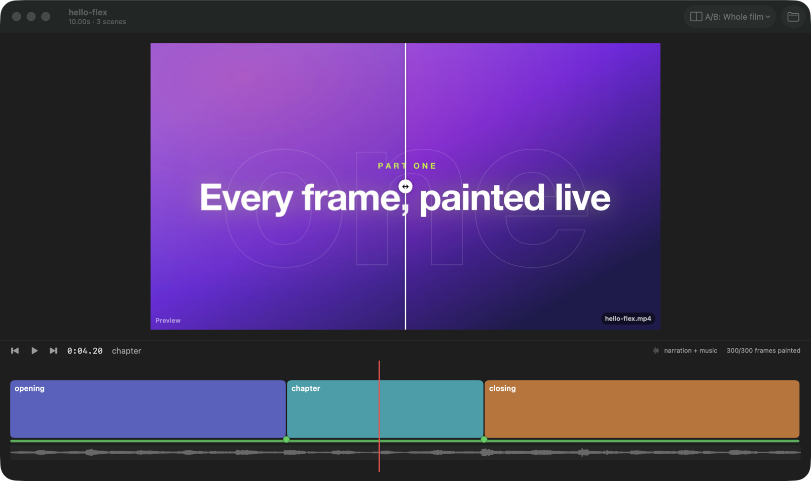

# Variants, renders and stills

## Variants

- **What:** A film can declare variants: env flags its scenes read, each with its values, the
  first being the default (circles-overview: `END` = `white` or `dark`). The toolbar has a menu
  per variant (`END: white`). Choosing a value restarts the engine's session with that flag. Frames
  are cached by their contents, so only the frames the flag changes repaint (376 of 4,303 for
  `END=dark`).
- **Reach it:** The variant's toolbar menu. From the terminal: `--variant NAME=VALUE` on any
  `flex` command ([The flex command](06-cli.md)).
- **State:** Per window, for as long as the project is open; a new window starts on the defaults.
- **Limits:** Only projects that export `variants` show the menu.

## Renders and A/B

- **What:** The **Renders** menu lists the project's finished renders: the mp4s in its renders
  folder whose names are the project's. Each one shows whether it is the whole film, one scene
  (`--scene`, e.g. "Scene book") or a size (`@4k`), with its size and date. Pick one to A/B it:
  it plays in sync with the preview, following the playhead (playing, paused or scrubbing),
  **side by side** or as a **wipe** (drag the divider: preview on the left, render on the
  right). A scene render starts at its scene, and outside that scene the pane says so. The
  render is muted, because the sound is the preview's mix.
- **The renders folder:** By default `~/Downloads/flex-videos/<project>/`, created on first use.
  **Choose Renders Folder…** picks another folder for this project, and Flex remembers it. Renders
  the pipeline made in `~/Downloads/fancy-e2e-videos/<out>/` can be reached three ways: choose
  that folder, use the menu's **Use the Pipeline's Folder** item, or add them one by one.
- **Add Render…** opens any video from wherever it lives and keeps it in this project's list
  (remove it again from the same menu).
- **Reach it:** The toolbar's Renders menu: pick a render, then Side by Side or Wipe, or
  Stop Comparing.
- **State:** The folder and the added videos are remembered per project
  (`defaults read dev.waky.flex`, keys `rendersFolder:<path>` and `addedRenders:<path>`).
- **Limits:** Labs (`<project>-lab-…`) are other projects and aren't listed. A render made from an
  older version of the film can differ from the preview; that is what A/B is for.

## Export a still

- **What:** Exports the frame under the playhead as a PNG at 1920, 3840 or a custom width,
  painted by the engine at that size. It is not a screenshot of the view.
- **Reach it:** File › Export Still… (⇧⌘E). A standard save panel picks the folder and name
  (default `<project>-<timecode>.png`). From the terminal: `flex frame <dir> <frame|12.5s> -o x.png --width 3840`.
- **State:** The last folder is remembered per project (`exportFolder:<path>`). The first time
  it starts in `~/Downloads/flex-videos/<project>/`.
- **Limits:** A frame that can't be painted (a scene that threw) shows its error instead.

## Launch options (for scripts)

`-variant END=dark` opens on a variant. `-compare <file name>` opens A/B on a render in the
renders folder, and `-compareMode wipe` makes it a wipe.
