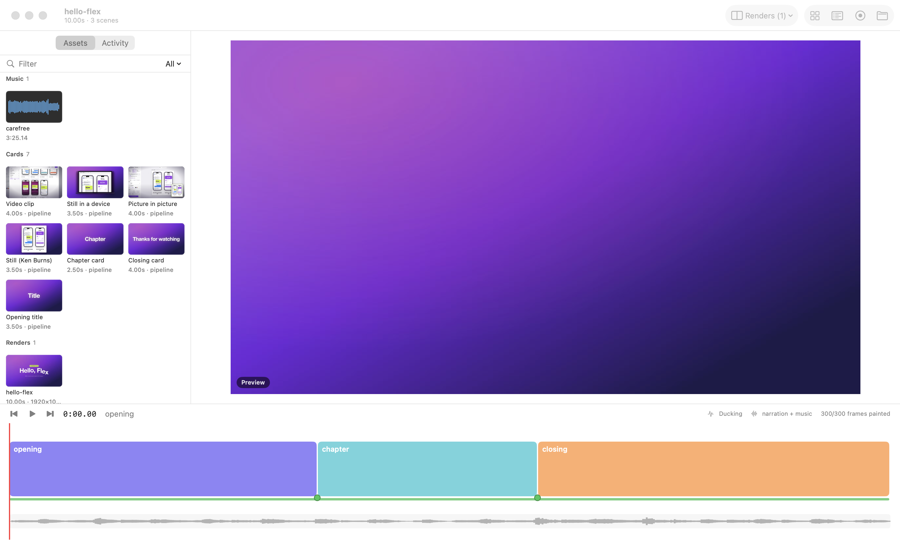
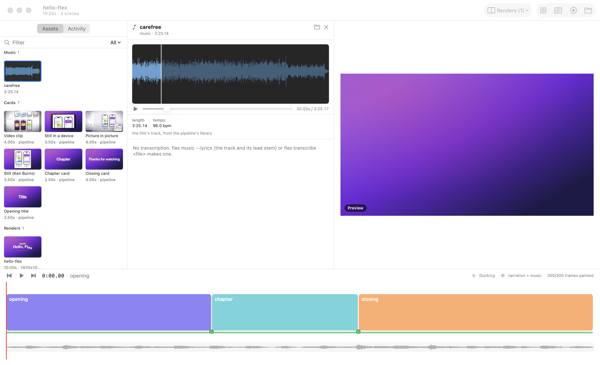
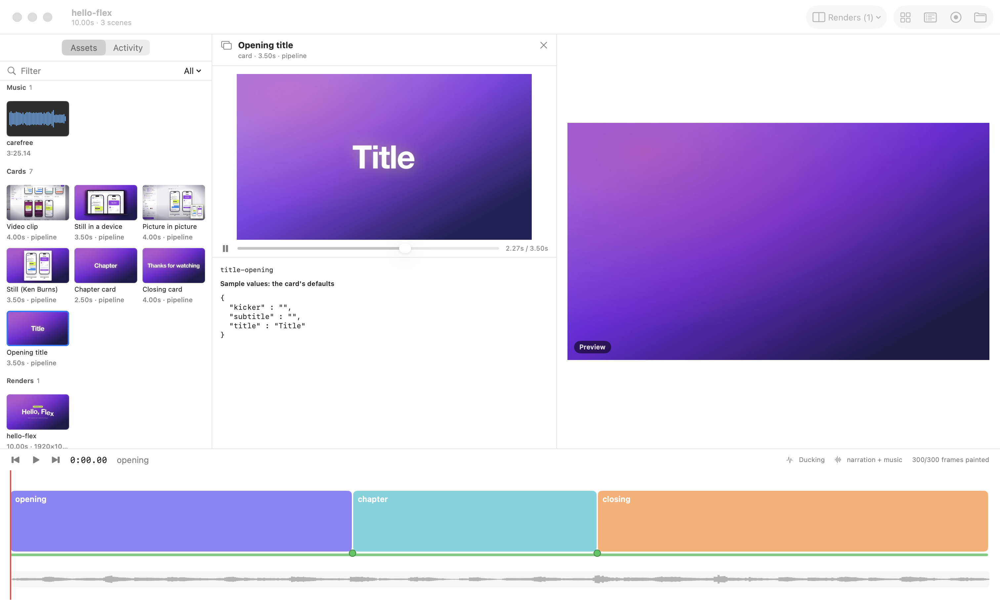
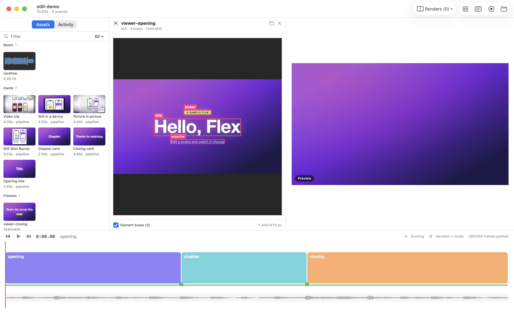

# Assets

Tools measure; the film decides. The assets panel shows what the project has and what can be measured about it.
It never ranks a piece or picks one.

## The grid



- **What:** A grid of everything the film is made from, grouped by kind. Nothing is registered by hand: a piece shows
  up because it is a file in the project, or an entry in its `audio.json`, or a render in its renders folder. An
  agent that writes a card, a sound or a take sees it appear in the grid within two seconds.
  - **Music:** `audio.json`'s tracks, with their `.grid.json`, `.lyrics.json` and `.music.json` (from `flex music`).
    Also the film's track when it comes from the pipeline's library (hello-flex's).
  - **Stems:** the files in the `stems` folder. The lead-vocal stem carries the track's words, because they were
    heard in it.
  - **Sounds:** `audio.json`'s `sfx`, and any other audio file under `audio/` (marked "not in audio.json").
  - **Takes:** each take in `takes/` (the version the film plays), with its versions from `takes/.versions/<take>/`
    under it. The picked one is marked with a star.
  - **Cards:** the project's own (`cards/`, `look.ts`) and the pipeline's built-in ones. A file under `cards/` that
    registers no card (a lift, a count-up) is shown as "a piece, no card": other cards use it, and it has no preview
    alone.
  - **Looks** (`look.ts`), **labs** (sibling folders whose `project.ts` imports this project or targets it), **freezes**
    (`assets/freezes/`), **stills** (`storyboard/`, with their element boxes), the **storyboard**'s sketches
    (`storyboard/sketches/` and any file a `script.json` panel names, with the beats that use them), **images** (anything else under
    `assets/`) and **renders** (the renders folder).
- **Tiles:** a waveform for audio, a take's first frame, a card's middle frame, the image for stills, a still from a
  render. Under each is a short line of what was measured:
  - length, loudness (as `audio.json` records it), word count;
  - "frames played": the frames in `events.json`, which is what the film plays after retiming, not the folder's file
    count;
  - which version is picked, and beats more than 40 ms late;
  - a still's boxes and pixel size.
  
  Hover a tile for its id and what the project says about it (`audio.json`'s purpose or mood, a version's note).
- **Images and stills** come in numbers (circles-overview has over 200), so they are grouped by folder. Each folder
  is folded, with a count; click its header to unfold it. Typing in the filter unfolds every match.
- **"No sample values":** a card is previewed with its sample values: its own exported `preview` once the card list
  reports one, else its defaults. When the picture it draws is a single flat colour, its tile says "no sample values".
  The card isn't hidden: some cards need a page or a take to draw anything.
- **Made by an agent:** when the activity trail knows which agent made a piece, its tile shows a ✦ mark with the name.
  Without that record, there is no mark.
- **Reach it:** the toolbar's Assets button, or ⌥⌘1 (the side panel, left of the viewer). Use the filter field
  (title, path, note or card type) and the kind menu (All, Music, Stems, Takes…).
- **State:** Nothing is stored. The panel rescans every two seconds while it's open, which takes about 10 ms. The
  slow parts are made once, in the background, and cached in Flex's support folder (`assets/`):
  - the card list runs the pipeline, 2–4 s, and is cached until `look.ts`, `project.ts` or a card file changes;
  - a card's still and clip;
  - a take's playable copy;
  - a render's still.

## The source viewer

Click a tile and it opens in the source viewer, between the panel and the film's viewer. There it plays on its own:
the film's playhead doesn't move. The ✕ or Esc closes it.



- **Audio:** the waveform with a playhead (click or drag on it to seek), play and pause (⌥Space), and the measured
  facts: length, loudness, peak, tempo, words. Where a transcription exists, the words are listed line by line as
  they were heard. The word sounding now lights up, with its bar.beat on the film's grid. Click a line's time to seek
  there. The transcription comes from `flex music --lyrics` for the track and its lead stem, or `flex transcribe`
  for any file. Without one, the viewer says how to make one.
- **A take or a version:** the recording as it was captured, raw, on the take's own clock. Flex encodes a playable
  copy the first time (a few seconds) and shows the first frame meanwhile. Beside it:
  - the frames played, the viewport and its density;
  - whether this version is the pick;
  - the take's versions (click one to open it);
  - the timing report: each beat's lateness and each mark's offset and drift against the pick.



- **A card:** rendered alone by `flex card` with its sample values, looping. Its type, where its sample values come
  from, and the values themselves are shown under it.
- **A still, a freeze or an image:** the image, with its element boxes drawn and named (`capture.walk.elements`;
  the checkbox hides them).
- **A render:** plays. **A lab:** its newest render plays, when it has one. **A look**, or a piece that isn't a card:
  its file, with Open in Editor.



## For agents: `flex assets`

The same scan and the same previews, from the terminal:

```sh
flex assets <dir>                    # the grid as text, grouped by kind (images folded by folder)
flex assets <dir> --kind take,card   # only these kinds (all their entries, images unfolded)
flex assets <dir> --json             # every asset with its measured facts
flex assets <dir> --preview <id|path> -o x.png|x.mp4 [--width 1280]
```

`--preview` writes an asset the way the source viewer shows it:
- **audio:** a sheet of its waveform with its words at their times (`.png`), with the words also printed;
- **a take or version:** its playable copy (`.mp4`) or its first frame;
- **a card:** a clip or its middle frame;
- **a still:** with its boxes drawn;
- **a sketch:** drawn (an SVG) or as it is;
- **a render:** a still from it.

The scan lists the cards through the pipeline when its cached list is stale; `--cached` skips that. An asset's id is
its project path, or `audio.json#music/<key>`, `audio.json#sfx/<key>`, `cards/<file>.ts#<name>`, `look.ts#<name>`,
`card:<type>`, `../<lab>` or `render:<file>`. A path to any of its files finds it too.

## Launch options (for scripts)

- `-panel assets` opens the panel.
- `-openAsset <id or path>` opens an asset in the source viewer.
- `-assetAt <seconds>` puts the source at a moment, and `-assetPlay YES` plays it.
- `-assetKind <kind>` shows one kind.

## Limits

- A card's sample values are its defaults until the card list reports an exported `preview` (params and a length)
  beside the card. A card that needs a page or a take draws nothing with its defaults; its tile says "no sample
  values".
- Lengths come from file headers (WAV, mp4); other audio formats are measured once by ffprobe and remembered.
- Loudness is what `audio.json` records; the panel doesn't measure it again.
- A lab plays its newest render; playing a lab live, in place in the film, is the labs section of the plan.
- Dragging a piece onto the timeline is not built yet.
