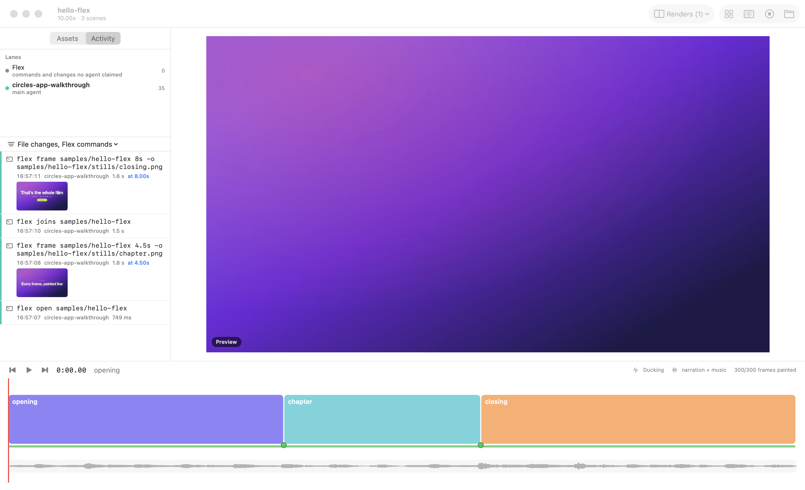

# Activity trail

Flex records; it doesn't restrict. An agent making a film stays free to invent: its own scripts, cards, labs, a way
around a gap. The activity trail is how you follow along. Three sources go on one clock:

1. **Every `flex` command:** what ran, its arguments, the outcome, how long it took and what it made (a still, a render,
   a take version).
2. **Every change to the project's text files**, each with its diff.
3. **The agents' own account:** Claude Code's session transcripts, read in place and never copied. A subagent has its
   own transcript, so it gets its own lane, under the agent that spawned it.



## The Activity panel

- **What:** A column left of the viewer. At the top are the **lanes**:
  - Flex's own lane, for commands and changes no agent claimed;
  - each Claude Code session's main agent;
  - each subagent, indented under its parent, with a check mark once it has reported back.

  Lanes for agents that only **read** the project (for example an agent studying the film as prior art for another
  one) come after the ones that worked in it, dimmed. Below the lanes are the **events**, newest first. Each event
  has a coloured bar for its lane, the time, how long it took, and whether it failed.
- **Live:** While the panel shows, it reads what is new every 1.5 s. Events appear as the agent works.
  - A `flex` command an agent ran replaces the Bash call that ran it.
  - A failed tool call turns red.
  - An agent's Edit shows the file's real diff once the change is seen.
- **Thumbnails:** The stills a command made show under it. Renders, sounds and take versions show as chips.
- **Clicks:**
  - A command about a film time (`flex frame <dir> 12.5s`) moves the playhead there.
  - An event with a diff or more text opens it inline: a file change, an Edit or Write, an error, a long message.
  - A thumbnail or chip opens what was made in the assets panel. Something outside the project is shown in Finder.
- **Filters:** Click lanes to show only them (**All** clears that). The filter menu picks the kinds: Flex commands,
  file changes, prompts and messages, tool calls, subagents and reports.
- **Reach it:** The side panel's **Activity** tab (⌥⌘2). At launch: `-panel activity`. For scripts and screenshots:
  - `-activitySince 2h` (default `24h`);
  - `-activityLane <lane id or words of its label>`;
  - `-activityKind command,change`;
  - `-activityExpand <words of an event's title>`.

## From the terminal

```sh
flex activity <dir>                      # lanes, then every event since 24h ago, oldest first
flex activity <dir> --since 2h           # or 30m, 2d, a time (2026-10-17T05:00:00Z), all
flex activity <dir> --follow             # keep printing new events as they happen
flex activity <dir> --lane "Scene lane" --kind command --kind change
flex activity <dir> --json               # { schema, project, since, lanes, events }; with --follow, one event per line
flex activity <dir> --no-agents          # only Flex's own log
```

`flex activity` only reads, and it is never recorded itself.

## How it works

- **Commands:** Every `flex` command appends one line to `<project>/.flex/activity.jsonl` when it ends. The line holds
  its argv (anything that looks like a key or token is redacted), the cwd, the outcome and error, the duration, and
  what it made:
  - files in the project, the output folder (`~/Downloads/flex-videos/<film>/`) or the cwd that changed during the run;
  - whatever it was told to write with `-o`;
  - a take version counted as one item, never its frames.

  It costs about 2 ms per command (30 ms the first time). `FLEX_ACTIVITY=off` turns it off. Commands that name no
  project (`flex doctor`, `flex read`, `flex key`) go to `~/Library/Application Support/Flex/activity.jsonl`, which
  the panel doesn't show yet.
- **File changes, with or without the app:** Flex keeps a shadow copy of the project's text files in `.flex/shadow/`.
  Each recorded command compares the project with it when it ends, and so does the open panel each time it polls. A
  change during a command is that command's.
  - **Followed:** text files up to 256 KB, up to 16 MB in all.
  - **Not followed:** node_modules, take frames (only each take's `edl.json` is followed), the storyboard, audio
    analyses and build output.
  - The first sync only takes a baseline.
- **Who did it:** Claude Code puts the session's id in the environment of its Bash tool, so each command records it.
  - **Commands:** a subagent's commands carry its parent session's id, so the trail matches the command to the Bash
    call (main agent or subagent) that ran it.
  - **Changes:** a change between commands goes to the agent whose Edit or Write touched that file at that time. Failing
    that, it goes to a Bash call running at that moment, marked **lane guessed**. Failing that, to Flex's lane.
- **Which sessions belong to a project:** Transcripts live in `~/.claude/projects/<folder>/`, with subagents in
  `<session>/subagents/` (`FLEX_CLAUDE_PROJECTS` points elsewhere). A session belongs to the project when:
  - it started in the project;
  - it ran recorded commands on it;
  - or its tool calls or cwd name a path in it (its real path, the path as given, or `~/…`).

  The first read scans the day's transcripts: about a second per GB. Flex remembers how far it has read (offsets only,
  in its support folder), so later reads are instant.
- **Privacy:** Transcripts are read in place and never copied into the project. Projects get committed, and
  transcripts can hold secrets.

## Limits

- An agent's own text is kept to its first lines. The full transcript stays where Claude Code keeps it.
- Only Claude Code's transcripts are read. Commands run by other agents show in Flex's lane, with the agent's name
  when it sets `AI_AGENT`.
- Two agents in one session running the same `flex` subcommand at the same moment could be swapped. A `flex` command
  run from inside a script goes to the session's main lane.
- Changes made only through shell commands (`sed -i`, a script) are credited to the agent by timing, marked
  **lane guessed**. Such an agent's lane is still marked as reading the project.
- An agent that reads the project only through relative paths, from a working folder outside it, isn't found.
- `.flex/` belongs in the project's `.gitignore`. `flex new` adds it.
