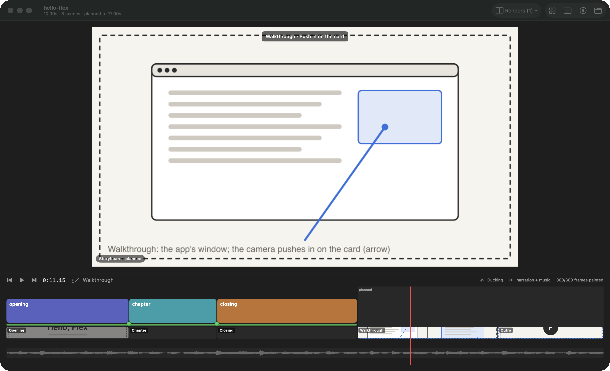
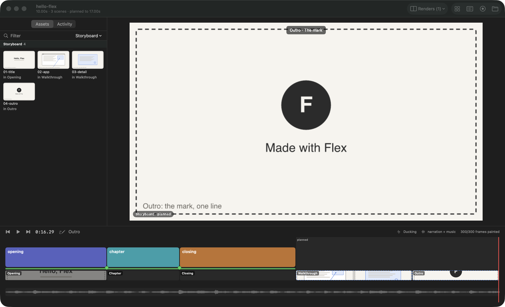
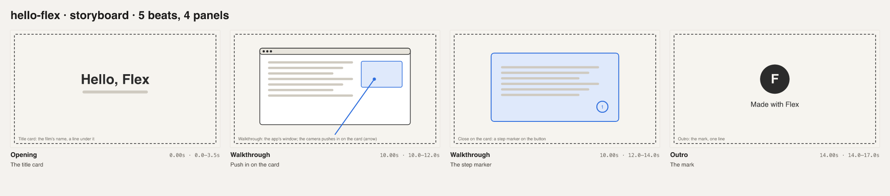

# Storyboard

Tools measure; the film decides. The script is the film's plan, written by whoever makes the film (an agent or the
author): its beats on the film's bars, their narration, and panels (sketches its maker draws). Flex places it on the
film's clock, shows it and measures it. It never writes the script, draws a panel or judges one.



The script lives in the project as `script.json`, and the sketches as files beside it (by convention
`storyboard/sketches/`). The format is in [Making a film](../making-a-film.md#the-script-and-the-storyboard).

## The storyboard lane

- **What:** A lane under the scenes, when the project has a `script.json`. Each beat is a band over its bars, with its
  title. Each panel is the sketch's thumbnail across its stretch of the beat:
  - a beat the script marks `built` is faint (the film has it now);
  - a beat that isn't built yet is drawn in full;
  - a beat past the film's end (planned) has a dashed outline;
  - a panel whose sketch file is missing is a red block with a question mark.

  Hover a beat for its bars and times, its status and its narration; hover a panel for its file and caption.
- **The plan past the film's end:** a beat can be placed past what's built. The timeline then runs on to the plan's
  length, and the stretch past the film's end is shaded and labelled "planned" across every lane. The window's subtitle
  says how long the plan is ("10.00s · 3 scenes · planned to 17.00s").
- **State:** Read from `script.json`. Editing it, or a sketch, reloads the storyboard alone (within a second or two); the
  film's frames, its sound and its join check aren't touched.

## The viewer as animatic

- **What:** Wherever the film isn't built, the viewer shows the beat's panel instead of a frame:
  - in a beat the script marks as not built (any `status` but `built`), over the film's own frames;
  - past the film's end, in the planned beats.

  The panel fills the stage, with the beat's title and the panel's caption above it; the corner tag reads "Storyboard"
  (or "Storyboard · planned"), and the transport names the beat. A beat with no panel shows its title on a blank card.
  Where the film is built, its frames show as always.
- **Playback** runs on past the film's end, through the planned beats, in silence once the track ends. So the whole
  plan plays over the track from the first day, and fills in as the film is built: mark a beat `built` and its frames
  replace its panels.

## In the assets panel



- **What:** A **Storyboard** group: every sketch under `storyboard/sketches/`, and any file a panel names elsewhere. Each
  tile says which beats use it ("in Walkthrough"), or "in no beat". An SVG sketch is drawn for its tile and in the
  source viewer. The rest of `storyboard/` (`flex walk`'s screenshots) stays under Stills.
- **The activity trail** follows `script.json` and `storyboard/sketches/` as text files, each change with its diff.

## For agents: `flex script` and `flex storyboard`

```sh
flex script <dir>                      # the beats on the film's clock, their narration, and what can be measured
flex script <dir> --json
flex storyboard <dir> [--sheet x.png] [--cols 4] [--width 480]   # the panels as one sheet
flex storyboard <dir> --animatic x.mp4 [--width 1280]            # each panel over its bars, the film's track under it
```

`flex script` notes what it can measure: a position that doesn't parse, beats that overlap or leave a gap, a missing
sketch, a narration line outside its beat. The sheet defaults to `storyboard.png` in the film's output folder
(`~/Downloads/flex-videos/<film>/`). The animatic runs the plan's length, with silence past the track.



## Launch options (for scripts)

- `-startAt <frame>` works past the film's end: it applies once the plan is known.

## Limits

- Panels are pictures: an SVG or a PNG/JPG. Flex doesn't animate within a panel; a beat's camera move is drawn in its
  sketch (an arrow, a dashed frame).
- A beat placed in `bar.beat` needs the film grid (`flex music`). Without one, use seconds (`"12.5s"`). Past the grid's
  last bar, positions carry on at the track's tempo, four beats a bar.
- The planned stretch has no sound of its own: the track ends where the film's music edit ends.
