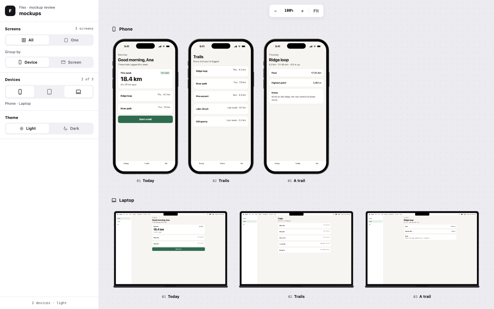
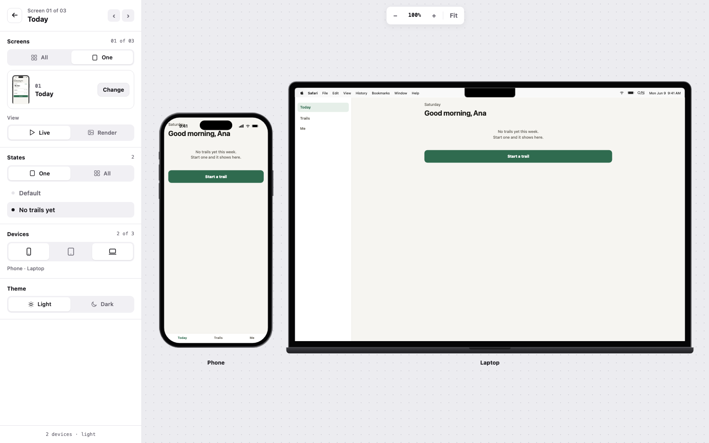
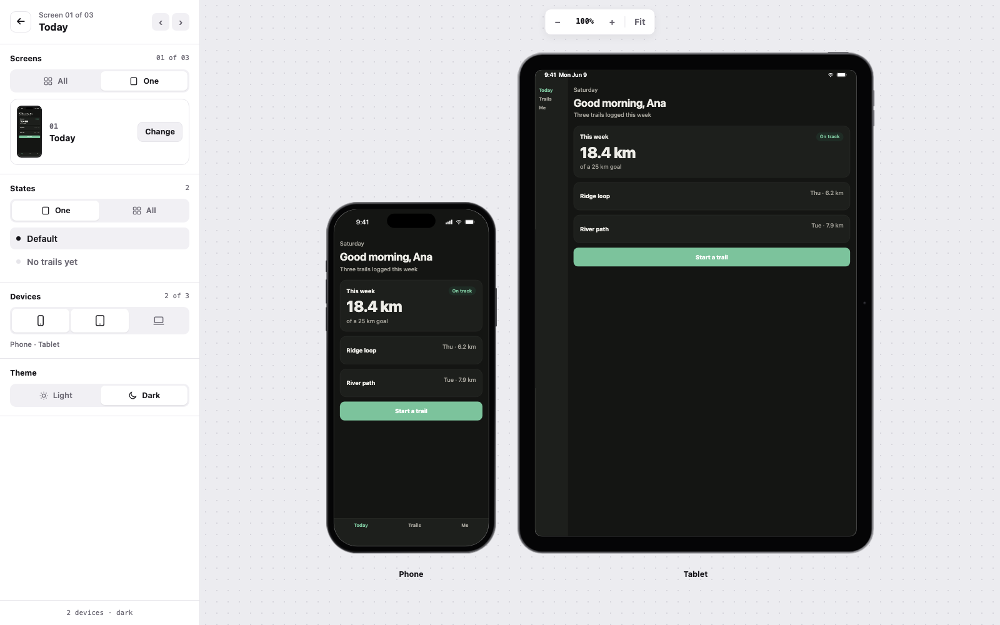

# Screens and mockups

Tools measure; the film decides. Flex freezes the screens it's given, frames them in devices and lays them out to look
at. Which screens, which states and how they're shown in a film or a deck are the maker's calls.

The examples here use `samples/screens`, a three-page sample app ("Trail log") with a phone layout, a tablet rail and a
laptop sidebar. Serve it with `python3 -m http.server 8102 -d samples/screens`.

## Freezing screens: flex screens

- **What:** Each screen of a running web app, frozen to one self-contained HTML file per device and theme: styles,
  fonts and images inlined, scripts removed, canvases (a map, a chart) screenshotted once their pixels settle.
- **How:** `flex screens samples/screens/screens.json` (or URLs). The list names its `base`, its `devices` and its
  `screens`, each a `name`, `label` and `path`:

  ```json
  { "base": "http://localhost:8102", "devices": ["iphone", "ipad-11", "mac"],
    "screens": [{ "name": "today", "label": "Today", "path": "/home.html",
                  "states": [{ "name": "empty", "label": "No trails yet", "path": "/home.html?empty=1" }] }] }
  ```

- **States:** a screen's `states` are frozen as `<screen>@<state>`. `axes` compose instead: a select (its first option
  the default) or a toggle, each setting `params` on the path. Every combination is frozen (`home@paul+offline`).
- **Devices and safe areas:** each page loads at the device's own size with its safe areas, so an app that sizes its
  bars itself bakes the right insets in. Each freeze pins its colour scheme.
- **State:** `<dir>/<device>/<name>.<theme>.html`, with `order.json` and `index.json` (screens, labels, states, each
  screen's link) beside them. `--index-only` writes the index alone, for a live canvas (below).

## Device frames: flex mockup

- **What:** Screens in device frames as transparent PNGs, one per screen, device and theme
  (`<screen>-<device>-<theme>.png`).
- **How:** `flex mockup <frozen folder | pages | screenshots>`. `--theme both`, `--sheet` (a contact sheet),
  `--device`, `--finish` (a named finish, or any colour on a frame that takes a tint), `--status`, `--shadow`, `--bg`.
- **Devices:** iPhone, iPad (portrait and landscape), Mac, an Android phone, a display. The status bar is `auto`: dark
  glyphs over a light screen, light over a dark one, unless a frozen screen asks otherwise.

## The review page: --review



- **What:** `review.html` beside the PNGs: a canvas of every screen, grouped by device or by screen, with zoom and pan.
  Pick one screen to see its states, one at a time or all together, on the devices you choose, light or dark.
- **Live or render:** a single screen shows its frozen page running in the frame (Live) or the PNG (Render).
- **Counts:** the screen picker (list or grid) and the canvas say how many states each screen has; a flow review's flow
  picker says how many screens each flow has.
- **Opening a screen** lands on all its states (a screen without states, on itself), whether from a picker, the canvas
  or the keys.
- **← / →** move at the level shown: all screens → between lists (a flow review's flows); one screen → its list's
  screens; one state → its screen's states. Past an end they roll into the next item up, and wrap at the last list.
- **Device selection** works as in Finder: a click picks one device, Shift-click a range, ⌘-click adds or removes one.
- **Peek** (`flex review peek <flow | flow/screen | flow/screen@state>… --title t`): a temporary flow of screens from
  any flows, first on the board's home and marked Temporary until dismissed (×), replaced, or `--clear`ed. It lives in
  `.flex/cache/`, so it's never committed; a note made on it goes to the screen's own flow.
- **Command bar** (⌘/ on a flow review's home and flow pages): as Raycast, one ranked list of one-line results over
  flows, screens, states and people (⌘P filters to a kind, recent, a tag or a person), starting where you are (this screen's states, this flow's screens), a filter icon (its chip at the search's start), Pinned, a footer with Open ↵ and Actions ⌘K (states,
  pin, peek, peek all, copy link). Modifiers in the search (`as Sofia`, `as a visitor`, `dark`, `sw`, `on iPad`,
  `offline`, `tester`) show as chips and ↵ opens the result with them set, as the View panel would; a role fans out one
  row per person. Tags (`"tags"` on a flow, screen or state; the project's own beside Flex's
  defaults, in `project.json`) colour the filter and the canvas captions.
- **Zoom** lives in the View panel (⌘+ ⌘− ⌘0 and pinching as before); **Compact search** there too.
- **Device frame** (a toggle in the View panel's header row): off, each screen shows as the app's window alone, without the device's body, status
  bar, notch or camera. A phone or tablet's page is cropped to its safe areas, so its snapshot and its live frame agree.
  It is kept in the address (`frame=0`) and, on a flow review, remembered per project.
- **System screens** (a flow review's `"system"` on a screen or state): the OS's own UI drawn over the app's frame in
  CSS, the iOS contact picker or permission alert on an iPhone or iPad, Material 3's on Android, nothing on a laptop.
  It follows the theme, language and Device frame; notes and ⌥-copy are of the app underneath (`server/system.mts`).



## Placing devices by reference: embed.html and canvas.html

`--review` also writes two pages that other pages embed in an iframe, so a deck or a film places Flex's devices by
reference instead of copying PNGs:

- **`embed.html?screen=…&device=…&theme=…[&finish=…]`**: one device, fitted to the iframe, padded as its PNG is.
- **`canvas.html`**: a 1920 × 1080 stage of devices under a camera.
  - One device (`screen`, `device`, `theme`, `finish`, `place=left,top,width`) or several (`d=screen/device/theme/finish:left,top,width`, repeated).
  - The camera: `camera=zoom,x,y`, named `views=name:zoom,x,y|…` (the first is the stage at rest), `view=` to start on one.
  - `controls=all` or some of `zoom,pan,views,devices,theme,states`: Flex's controls float over the canvas, showing
    while the pointer moves and fading after.



- **Driven by its host:** the page around it posts messages to move it, and hears where it is:
  - in: `{ flex: "camera", zoom, x, y, animate? }`, `{ flex: "view", name }`, `{ flex: "set", name, value }` (device,
    theme, a state axis);
  - out: `{ flex: "view", name, rest, camera }` as the camera moves, `{ flex: "stage", w, h, items, views }` (the
    devices' rectangles, for a minimap), `{ flex: "controls", controls }` (what `set` can set), `{ flex: "state", … }`.

  A Deck presenter drives a slide's canvas this way, the way a film's push-ins move it.

## A live screen canvas: --canvas

- **What:** The review page for a site, with its frames running the app itself rather than frozen pages.
- **How:** `flex screens <list> -o <dir> --index-only`, then `flex mockup <dir> --canvas <base>` (a path on the same
  site, or a URL). It writes `index.html`.
- **The app's part:** each frame's link asks for its theme (`scheme=light|dark`) and, on a phone or tablet, its safe
  areas (`insets=top,bottom`), since a browser inside a frame reports neither. The app applies them for that frame
  only. `samples/screens/frame.js` shows the smallest way to do it.
